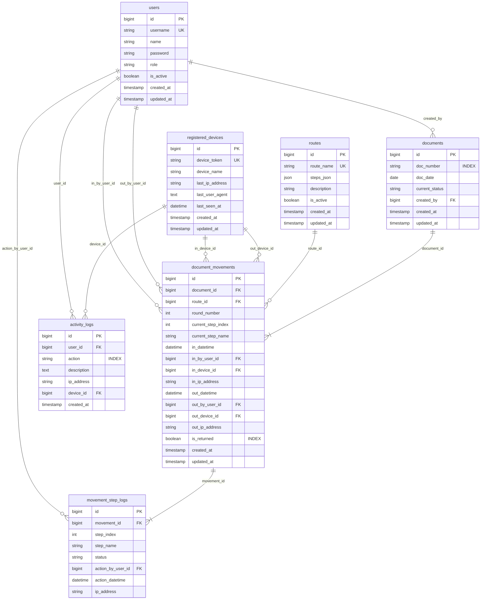

# Flow-D: Government Document Routing & Tracking System
### ระบบติดตามและจัดการเส้นทางเอกสารราชการแบบเรียลไทม์

[](https://laravel.com)
[](https://php.net)
[](https://tailwindcss.com)
[](https://mariadb.org)
[](tests)

**Flow-D** คือระบบสารบรรณและติดตามการหมุนเวียนเอกสารราชการยุคใหม่ ออกแบบภายใต้แนวคิด **"Fast-Intake & Single-Action Flow"** เพื่อรองรับการทำงานความเร็วสูงสำหรับเจ้าหน้าที่ธุรการหน้าห้อง พร้อมหน้าจอสำหรับประชาชนและผู้บริหารในการติดตามสถานะแบบเรียลไทม์ผ่านมือถือ (Mobile / LINE LIFF)

---

## สารบัญ (Table of Contents)

1. [คุณสมบัติเด่นของระบบ (Key Features)](#คุณสมบัติเด่นของระบบ-key-features)
2. [สถาปัตยกรรมระบบ (System Architecture)](#สถาปัตยกรรมระบบ-system-architecture)
3. [แผนภาพโครงสร้างฐานข้อมูล (Entity-Relationship Diagram)](#แผนภาพโครงสร้างฐานข้อมูล-entity-relationship-diagram)
4. [พจนานุกรมข้อมูล (Data Dictionary)](#พจนานุกรมข้อมูล-data-dictionary)
5. [คู่มือการติดตั้งและตั้งค่าระบบ (Installation Guide)](#คู่มือการติดตั้งและตั้งค่าระบบ-installation-guide)
   - [ความต้องการของระบบ (Prerequisites)](#ความต้องการของระบบ-prerequisites)
   - [การติดตั้งสำหรับ Local Development (SQLite)](#การติดตั้งสำหรับ-local-development-sqlite)
   - [การติดตั้งสำหรับ Production Server (MariaDB / MySQL)](#การติดตั้งสำหรับ-production-server-mariadb--mysql)
   - [การตั้งค่าเว็บเซิร์ฟเวอร์ (Nginx Configuration)](#การตั้งค่าเว็บเซิร์ฟเวอร์-nginx-configuration)
6. [บัญชีผู้ใช้งานเริ่มต้น (Default Credentials)](#บัญชีผู้ใช้งานเริ่มต้น-default-credentials)
7. [คีย์ลัดการใช้งานสำหรับเจ้าหน้าที่ (Keyboard Shortcuts)](#คีย์ลัดการใช้งานสำหรับเจ้าหน้าที่-keyboard-shortcuts)
8. [คำถามที่พบบ่อยและการแก้ไขปัญหา (Troubleshooting & FAQ)](#คำถามที่พบบ่อยและการแก้ไขปัญหา-troubleshooting--faq)

---

## คุณสมบัติเด่นของระบบ (Key Features)

- **Dual-Pane High-Velocity Dashboard**:
  - แผงซ้าย: บันทึกรับหนังสือเข้าอย่างรวดเร็ว รองรับ Barcode Scanner พร้อม Shortcut `Alt+N` หรือ `/` และกด `Enter` รับเข้าทันที
  - แผงขวา: รายการเอกสารที่กำลังอยู่ระหว่างดำเนินการ พร้อมระบบค้นหาแบบ Real-time Filter
- **Single Smart Action Button (ลดความผิดพลาด 100%)**:
  - ขั้นตอนระหว่างทาง: แสดงปุ่มสีน้ำเงิน `→ ส่งต่อ: [ชื่อขั้นตอนถัดไป]`
  - ขั้นตอนสุดท้าย: ปรับเป็นปุ่มสีเขียว `✓ ส่งต่อเสร็จสิ้น: [ชื่อขั้นตอนสุดท้าย]`
  - ป้องกันการกด Fast Checkout ข้ามขั้นตอนโดยไม่ตั้งใจ
- **Intake as Step 1 Normalization**:
  - ระบบจะกำหนดให้ขั้นตอนแรกของทุก Route คือ `1. บันทึกรับหนังสือเข้า` เสมอ เพื่อให้การนับลำดับและแสดงผลบนไทม์ไลน์ถูกต้องตรงกันทั้งระบบ
- **Real-Time Mobile & LINE LIFF Tracking**:
  - ตรวจสอบสถานะเอกสารได้โดยไม่ต้องล็อกอินผ่านมือถือหรือ LINE Official Account
  - แสดง Timeline แบบละเอียด พร้อมระบุผู้รับหนังสือเข้าและผู้ดำเนินการในแต่ละขั้นตอน
- **Typo Correction & Void Intake**:
  - แก้ไขเลขหนังสือผิดพลาดได้ทันที พร้อมบันทึกประวัติไว้ใน Audit Log
  - สิทธิ์ยกเลิกการรับเข้า (Void Intake) สำหรับเอกสารที่รับผิดหรือกดซ้ำ
- **Admin Same-Day Rollback**:
  - สิทธิ์ผู้ดูแลระบบ (Admin) สามารถกดถอยกลับขั้นตอน (Rollback) ในวันเดียวกันได้ หากมีการกดส่งต่อผิด
- **Executive Reports Module (`/reports`)**:
  - สรุปสถิติเอกสารตามช่วงเวลา (วันนี้, สัปดาห์นี้, เดือนนี้, ปีนี้, หรือกำหนดเอง)
  - รายงานแจกแจงตามเส้นทาง (Route Breakdown) พร้อมอัตราการดำเนินงานเสร็จสิ้น (%)
  - ทะเบียนคุมเอกสารพร้อม Print Preview สำหรับพิมพ์ลงกระดาษ A4 แนวนอน หรือ Export เป็น PDF

---

## สถาปัตยกรรมระบบ (System Architecture)

- **Backend Framework**: Laravel 12 (PHP 8.2+)
- **Database Engine**:
  - Development / Testing: SQLite
  - Production: MariaDB 10.6+ / MySQL 8.0+ (utf8mb4_unicode_ci)
- **Concurrency & Race Condition Control**:
  - ใช้ Pessimistic Locking (`lockForUpdate()`) ในทุกกระบวนการบันทึกรับเข้า, ส่งต่อ, ถอยกลับ และยกเลิก เพื่อป้องกันปัญหา Double-Click / Race Condition เมื่อมีเจ้าหน้าที่ทำงานพร้อมกัน
- **Device & Workstation Tracking**:
  - บันทึก Device Token (UUID Cookie), IP Address และ User Agent ในทุกการทำธุรกรรมเอกสาร

---

## แผนภาพโครงสร้างฐานข้อมูล (Entity-Relationship Diagram)



---

## พจนานุกรมข้อมูล (Data Dictionary)

### 1. ตาราง `users` (ผู้ใช้งานระบบ)
เก็บข้อมูลบัญชีผู้ใช้งาน เจ้าหน้าที่สารบรรณ และผู้ดูแลระบบ

| ชื่อคอลัมน์ (Field) | ชนิดข้อมูล (Data Type) | Nullable | Default | ดัชนี (Index/Key) | คำอธิบาย (Description) |
|---|---|:---:|:---:|:---:|---|
| `id` | BIGINT UNSIGNED | ไม่ | AUTO_INCREMENT | PRIMARY KEY | รหัสอ้างอิงผู้ใช้ |
| `username` | VARCHAR(50) | ไม่ | - | UNIQUE | ชื่อผู้ใช้สำหรับเข้าสู่ระบบ |
| `name` | VARCHAR(150) | ไม่ | - | - | ชื่อ-นามสกุล / ตำแหน่งของผู้ใช้ |
| `password` | VARCHAR(255) | ไม่ | - | - | รหัสผ่านเข้ารหัสแบบ Bcrypt/Argon2 |
| `role` | VARCHAR(20) | ไม่ | `'staff'` | - | สิทธิ์การใช้งาน (`admin`, `staff`) |
| `is_active` | TINYINT(1) / BOOLEAN | ไม่ | `1` (true) | - | สถานะเปิด/ปิดการใช้งานบัญชี |
| `remember_token` | VARCHAR(100) | ใช่ | NULL | - | โทเคนจดจำการเข้าสู่ระบบ |
| `created_at` | TIMESTAMP | ใช่ | NULL | - | วันเวลาที่สร้างบัญชี |
| `updated_at` | TIMESTAMP | ใช่ | NULL | - | วันเวลาที่แก้ไขข้อมูลล่าสุด |

---

### 2. ตาราง `registered_devices` (อุปกรณ์ / เครื่องประจำการ)
บันทึกและตรวจสอบสถานีทำงาน (Workstation) ผ่าน Cookie Device Token

| ชื่อคอลัมน์ (Field) | ชนิดข้อมูล (Data Type) | Nullable | Default | ดัชนี (Index/Key) | คำอธิบาย (Description) |
|---|---|:---:|:---:|:---:|---|
| `id` | BIGINT UNSIGNED | ไม่ | AUTO_INCREMENT | PRIMARY KEY | รหัสอ้างอิงอุปกรณ์ |
| `device_token` | VARCHAR(64) | ไม่ | - | UNIQUE | คีย์ระบุเครื่อง (UUID v4 บันทึกใน Cookie) |
| `device_name` | VARCHAR(150) | ใช่ | NULL | - | ชื่อเครื่องคอมพิวเตอร์/จุดประจำการ |
| `last_ip_address` | VARCHAR(45) | ใช่ | NULL | - | IP Address ล่าสุดที่อุปกรณ์เชื่อมต่อ |
| `last_user_agent` | TEXT | ใช่ | NULL | - | ข้อมูลเบราว์เซอร์และระบบปฏิบัติการล่าสุด |
| `last_seen_at` | DATETIME | ใช่ | NULL | - | วันเวลาที่เครื่องมีกิจกรรมล่าสุด |
| `created_at` | TIMESTAMP | ใช่ | NULL | - | วันเวลาที่ลงทะเบียนเครื่องครั้งแรก |
| `updated_at` | TIMESTAMP | ใช่ | NULL | - | วันเวลาที่อัปเดตข้อมูล |

---

### 3. ตาราง `routes` (เส้นทางเดินเอกสาร)
กำหนดรูปแบบเส้นทางการเดินเอกสารและลำดับขั้นตอนการปฏิบัติงาน

| ชื่อคอลัมน์ (Field) | ชนิดข้อมูล (Data Type) | Nullable | Default | ดัชนี (Index/Key) | คำอธิบาย (Description) |
|---|---|:---:|:---:|:---:|---|
| `id` | BIGINT UNSIGNED | ไม่ | AUTO_INCREMENT | PRIMARY KEY | รหัสอ้างอิงเส้นทาง |
| `route_name` | VARCHAR(255) | ไม่ | - | UNIQUE | ชื่อเส้นทางเดินเอกสาร (เช่น เส้นทางด่วน, งานพัสดุ) |
| `steps_json` | JSON | ใช่ | NULL | - | รายการขั้นตอนในรูปแบบ JSON Array (โดยเริ่มจาก `บันทึกรับหนังสือเข้า` เสมอ) |
| `description` | VARCHAR(255) | ใช่ | NULL | - | รายละเอียดคำอธิบายเพิ่มเติมของเส้นทาง |
| `is_active` | TINYINT(1) / BOOLEAN | ไม่ | `1` (true) | - | สถานะเปิดใช้งานเส้นทาง |
| `created_at` | TIMESTAMP | ใช่ | NULL | - | วันเวลาที่สร้างเส้นทาง |
| `updated_at` | TIMESTAMP | ใช่ | NULL | - | วันเวลาที่แก้ไขข้อมูล |

---

### 4. ตาราง `documents` (เอกสารหลัก)
จัดเก็บเอกสารสารบรรณแต่ละฉบับ

| ชื่อคอลัมน์ (Field) | ชนิดข้อมูล (Data Type) | Nullable | Default | ดัชนี (Index/Key) | คำอธิบาย (Description) |
|---|---|:---:|:---:|:---:|---|
| `id` | BIGINT UNSIGNED | ไม่ | AUTO_INCREMENT | PRIMARY KEY | รหัสอ้างอิงเอกสาร |
| `doc_number` | VARCHAR(100) | ไม่ | - | INDEX | เลขที่หนังสือราชการ (เช่น สธ 0201/ว123) |
| `doc_date` | DATE | ไม่ | - | - | ลงวันที่ของเอกสาร |
| `current_status` | VARCHAR(20) | ไม่ | `'in_progress'` | - | สถานะภาพรวม (`in_progress`, `completed`) |
| `created_by` | BIGINT UNSIGNED | ไม่ | - | FOREIGN KEY | รหัสผู้ใช้งานที่ลงทะเบียนรับเอกสารครั้งแรก (`users.id`) |
| `created_at` | TIMESTAMP | ใช่ | NULL | - | วันเวลาที่นำเอกสารเข้าสู่ระบบ |
| `updated_at` | TIMESTAMP | ใช่ | NULL | - | วันเวลาที่อัปเดตสถานะล่าสุด |

---

### 5. ตาราง `document_movements` (รอบการเคลื่อนไหวของเอกสาร)
บันทึกการเดินทางของเอกสารในแต่ละรอบ (รองรับการตีกลับเอกสารมาเดินรอบที่ 2, 3...)

| ชื่อคอลัมน์ (Field) | ชนิดข้อมูล (Data Type) | Nullable | Default | ดัชนี (Index/Key) | คำอธิบาย (Description) |
|---|---|:---:|:---:|:---:|---|
| `id` | BIGINT UNSIGNED | ไม่ | AUTO_INCREMENT | PRIMARY KEY | รหัสอ้างอิงรอบการเดินเอกสาร |
| `document_id` | BIGINT UNSIGNED | ไม่ | - | FOREIGN KEY | รหัสเอกสารหลัก (`documents.id` CASCADE DELETE) |
| `route_id` | BIGINT UNSIGNED | ไม่ | - | FOREIGN KEY | รหัสเส้นทางเดินเอกสารที่ใช้ (`routes.id`) |
| `round_number` | INT | ไม่ | `1` | - | ลำดับรอบการเดินเอกสาร (เริ่มที่ 1) |
| `current_step_index`| INT | ไม่ | `0` | - | ลำดับ Index ขั้นตอนปัจจุบัน (เริ่มที่ 0) |
| `current_step_name` | VARCHAR(100) | ใช่ | NULL | - | ชื่อขั้นตอนปัจจุบันที่เอกสารค้างอยู่ |
| `in_datetime` | DATETIME | ไม่ | - | - | วันเวลาที่รับเอกสารเข้ารอบนี้ |
| `in_by_user_id` | BIGINT UNSIGNED | ไม่ | - | FOREIGN KEY | ผู้รับเอกสารเข้าสู่ระบบ (`users.id`) |
| `in_device_id` | BIGINT UNSIGNED | ใช่ | NULL | FOREIGN KEY | อุปกรณ์ที่ใช้รับเข้า (`registered_devices.id`) |
| `in_ip_address` | VARCHAR(45) | ใช่ | NULL | - | IP Address ตอนรับเข้า |
| `out_datetime` | DATETIME | ใช่ | NULL | - | วันเวลาที่ส่งต่อเสร็จสิ้นรอบการเดินนี้ |
| `out_by_user_id` | BIGINT UNSIGNED | ใช่ | NULL | FOREIGN KEY | ผู้ลงนามหรือผู้ส่งต่อขั้นตอนสุดท้าย (`users.id`) |
| `out_device_id` | BIGINT UNSIGNED | ใช่ | NULL | FOREIGN KEY | อุปกรณ์ที่กดเสร็จสิ้น (`registered_devices.id`) |
| `out_ip_address` | VARCHAR(45) | ใช่ | NULL | - | IP Address ตอนกดเสร็จสิ้น |
| `is_returned` | TINYINT(1) / BOOLEAN | ไม่ | `0` (false) | INDEX | ระบุว่าเป็นรอบที่มีการตีกลับหรือไม่ |
| `created_at` | TIMESTAMP | ใช่ | NULL | - | วันเวลาที่สร้างระเบียน |
| `updated_at` | TIMESTAMP | ใช่ | NULL | - | วันเวลาที่อัปเดตระเบียน |

---

### 6. ตาราง `movement_step_logs` (ประวัติการดำเนินการแต่ละขั้นตอน)
บันทึกประวัติการขยับของเอกสารในแต่ละขั้นตอนอย่างละเอียด

| ชื่อคอลัมน์ (Field) | ชนิดข้อมูล (Data Type) | Nullable | Default | ดัชนี (Index/Key) | คำอธิบาย (Description) |
|---|---|:---:|:---:|:---:|---|
| `id` | BIGINT UNSIGNED | ไม่ | AUTO_INCREMENT | PRIMARY KEY | รหัสอ้างอิงประวัติขั้นตอน |
| `movement_id` | BIGINT UNSIGNED | ไม่ | - | FOREIGN KEY | รหัสรอบการเดินเอกสาร (`document_movements.id` CASCADE) |
| `step_index` | INT | ไม่ | - | - | ลำดับขั้นตอน (0, 1, 2, ...) |
| `step_name` | VARCHAR(100) | ไม่ | - | - | ชื่อขั้นตอน |
| `status` | VARCHAR(30) | ไม่ | - | - | สถานะขั้นตอน (`current`, `completed`, `rollbacked`) |
| `action_by_user_id` | BIGINT UNSIGNED | ใช่ | NULL | FOREIGN KEY | ผู้ดำเนินการในขั้นตอนนี้ (`users.id`) |
| `action_datetime` | DATETIME | ไม่ | - | - | วันเวลาที่ดำเนินการ |
| `ip_address` | VARCHAR(45) | ใช่ | NULL | - | IP Address ของผู้ดำเนินการ |

---

### 7. ตาราง `activity_logs` (บันทึกกิจกรรมและความปลอดภัยระบบ)
บันทึกประวัติความปลอดภัย เช่น การเข้าสู่ระบบ, การถอยขั้นตอน (Rollback), การแก้เลขหนังสือ (Typo Correction), การยกเลิกรับเข้า (Void Intake)

| ชื่อคอลัมน์ (Field) | ชนิดข้อมูล (Data Type) | Nullable | Default | ดัชนี (Index/Key) | คำอธิบาย (Description) |
|---|---|:---:|:---:|:---:|---|
| `id` | BIGINT UNSIGNED | ไม่ | AUTO_INCREMENT | PRIMARY KEY | รหัสบันทึกกิจกรรม |
| `user_id` | BIGINT UNSIGNED | ใช่ | NULL | FOREIGN KEY | ผู้ใช้งานที่กระทำกิจกรรม (`users.id`) |
| `action` | VARCHAR(50) | ไม่ | - | INDEX | ประเภทกิจกรรม (เช่น `void_intake`, `rollback_step`, `correct_doc_number`) |
| `description` | TEXT | ไม่ | - | - | รายละเอียดของกิจกรรม / เหตุผล |
| `ip_address` | VARCHAR(45) | ใช่ | NULL | - | IP Address ที่ส่งคำขอ |
| `device_id` | BIGINT UNSIGNED | ใช่ | NULL | FOREIGN KEY | อุปกรณ์ที่ใช้กระทำกิจกรรม (`registered_devices.id`) |
| `created_at` | TIMESTAMP | ไม่ | CURRENT_TIMESTAMP | - | วันเวลาที่เกิดกิจกรรม |

---

## คู่มือการติดตั้งและตั้งค่าระบบ (Installation Guide)

### ความต้องการของระบบ (Prerequisites)

- **PHP**: เวอร์ชัน 8.2 หรือสูงกว่า
- **PHP Extensions**:
  - `pdo_mysql` (สำหรับ MariaDB/MySQL) หรือ `pdo_sqlite` (สำหรับ SQLite)
  - `mbstring`, `openssl`, `bcmath`, `curl`, `json`, `fileinfo`, `tokenizer`, `xml`
- **Composer**: เวอร์ชัน 2.x
- **Node.js**: เวอร์ชัน 18.x หรือ 20.x ขึ้นไป และ **npm**
- **Database Engine**:
  - Development: SQLite 3.35+
  - Production: MariaDB 10.6+ หรือ MySQL 8.0+

---

### การติดตั้งสำหรับ Local Development (SQLite)

1. **โคลนคลังโค้ด (Clone Repository)**:
   ```bash
   git clone https://github.com/phumiphut-ta/flow-d.git
   cd flow-d
   ```

2. **ติดตั้ง Dependency ของ PHP และ Node.js**:
   ```bash
   composer install
   npm install
   ```

3. **คัดลอกไฟล์การตั้งค่าสภาพแวดล้อม (Environment File)**:
   ```bash
   cp .env.example .env
   php artisan key:generate
   ```

4. **สร้างฐานข้อมูล SQLite และรัน Migration พร้อมข้อมูลเริ่มต้น (Seed)**:
   ```bash
   touch database/database.sqlite
   php artisan migrate --seed
   ```

5. **คอมไพล์ Frontend Assets (Tailwind CSS & JavaScript)**:
   ```bash
   npm run build
   ```

6. **เปิดทดสอบการทำงานผ่าน Local Server**:
   ```bash
   php artisan serve
   ```
   เข้าใช้งานผ่านเบราว์เซอร์ที่: `http://127.0.0.1:8000`

---

### การติดตั้งสำหรับ Production Server (MariaDB / MySQL)

#### ขั้นตอนที่ 1: ติดตั้ง PHP Extensions ที่จำเป็น
- **Ubuntu / Debian**:
  ```bash
  sudo apt update
  sudo apt install -y php8.2 php8.2-fpm php8.2-mysql php8.2-mbstring \
                      php8.2-xml php8.2-bcmath php8.2-curl php8.2-zip mariadb-server nginx
  ```
- **RHEL / Rocky Linux / AlmaLinux**:
  ```bash
  sudo dnf install -y php php-fpm php-mysqlnd php-mbstring php-xml \
                      php-bcmath php-curl php-zip mariadb-server nginx
  ```

#### ขั้นตอนที่ 2: สร้างฐานข้อมูลบน MariaDB
เข้าสู่คอนโซล MariaDB:
```bash
sudo mysql -u root -p
```
รันคำสั่ง SQL สร้างฐานข้อมูลและกำหนดสิทธิ์ผู้ใช้:
```sql
CREATE DATABASE flow_d CHARACTER SET utf8mb4 COLLATE utf8mb4_unicode_ci;

CREATE USER 'flow_d_user'@'localhost' IDENTIFIED BY 'YOUR_SECURE_PASSWORD_HERE';
GRANT ALL PRIVILEGES ON flow_d.* TO 'flow_d_user'@'localhost';
FLUSH PRIVILEGES;
EXIT;
```

#### ขั้นตอนที่ 3: ตั้งค่าไฟล์ `.env` สำหรับ MariaDB
แก้ไขไฟล์ `.env` ของโปรเจกต์:
```env
APP_NAME=Flow-D
APP_ENV=production
APP_KEY=base64:... (สร้างจาก php artisan key:generate)
APP_DEBUG=false
APP_URL=https://flow-d.your-domain.go.th

DB_CONNECTION=mariadb
DB_HOST=127.0.0.1
DB_PORT=3306
DB_DATABASE=flow_d
DB_USERNAME=flow_d_user
DB_PASSWORD=YOUR_SECURE_PASSWORD_HERE
```

#### ขั้นตอนที่ 4: สั่งรัน Migration และ Seeder
```bash
php artisan migrate --seed --force
```

#### ขั้นตอนที่ 5: ปรับปรุงประสิทธิภาพของระบบ (Production Optimization)
เพิ่มความเร็วในการประมวลผลของ Laravel โดยการแคช Configuration, Routing และ Blade Views:
```bash
composer install --no-dev --optimize-autoloader
npm run build
php artisan config:cache
php artisan route:cache
php artisan view:cache
```

#### ขั้นตอนที่ 6: กำหนดสิทธิ์ไดเรกทอรี (Directory Permissions)
กำหนดให้ Web Server (`www-data` หรือ `nginx`) มีสิทธิ์เขียนลงใน `storage/` และ `bootstrap/cache/`:
```bash
sudo chown -R www-data:www-data /var/www/flow-d/storage /var/www/flow-d/bootstrap/cache
sudo chmod -R 775 /var/www/flow-d/storage /var/www/flow-d/bootstrap/cache
```

---

### การตั้งค่าเว็บเซิร์ฟเวอร์ (Nginx Configuration)

สร้างไฟล์ Virtual Host ที่ `/etc/nginx/sites-available/flow-d`:
```nginx
server {
    listen 80;
    server_name flow-d.your-domain.go.th;
    root /var/www/flow-d/public;

    add_header X-Frame-Options "SAMEORIGIN";
    add_header X-Content-Type-Options "nosniff";

    index index.php;
    charset utf-8;

    location / {
        try_files $uri $uri/ /index.php?$query_string;
    }

    location = /favicon.ico { access_log off; log_not_found off; }
    location = /robots.txt  { access_log off; log_not_found off; }

    error_page 404 /index.php;

    location ~ \.php$ {
        fastcgi_pass unix:/var/run/php/php8.2-fpm.sock;
        fastcgi_param SCRIPT_FILENAME $realpath_root$fastcgi_script_name;
        include fastcgi_params;
        fastcgi_hide_header X-Powered-By;
    }

    location ~ /\.(?!well-known).* {
        deny all;
    }
}
```

เปิดใช้งานไซต์และ Reload Nginx:
```bash
sudo ln -s /etc/nginx/sites-available/flow-d /etc/nginx/sites-enabled/
sudo nginx -t
sudo systemctl reload nginx
```

---

### การตั้งค่าเว็บเซิร์ฟเวอร์ IIS (Windows Server / Shared wwwroot)

ระบบ Flow-D ได้เตรียมไฟล์คอนฟิก **`web.config`** ไว้ให้ทั้งที่ **Root Directory** และโฟลเดอร์ **`public/`** ทำให้สามารถนำไปวางใน `C:\inetpub\wwwroot\flow-d` ร่วมกับเว็บอื่นๆ บน IIS ได้ทันที โดยระบบจะ Rewrite เข้าสู่โฟลเดอร์ `public` อัตโนมัติและป้องกันการดาวน์โหลดไฟล์ความลับ (`.env`, `.git`) โดยตรง

#### 1. สิทธิ์การเขียนไฟล์ (Folder Permissions)
เปิด Command Prompt (Run as Administrator) แล้วให้สิทธิ์แก่กลุ่ม `IIS_IUSRS`:
```cmd
icacls "C:\inetpub\wwwroot\flow-d\storage" /grant "IIS_IUSRS":(OI)(CI)M /T
icacls "C:\inetpub\wwwroot\flow-d\bootstrap\cache" /grant "IIS_IUSRS":(OI)(CI)M /T
```

#### 2. การตั้งค่า `.env` สำหรับ Sub-path บน IIS
หากเข้าใช้งานผ่าน `http://YOUR_SERVER_IP/flow-d`:
```env
APP_URL=http://YOUR_SERVER_IP/flow-d
ASSET_URL=/flow-d
```

#### 3. วิธีการนำขึ้น IIS (เลือกได้ 2 วิธี)
* **วิธีที่ 1 (แนะนำ - Add Application):** ใน IIS Manager คลิกขวาที่ `Default Web Site` -> **Add Application...** -> กำหนด Alias เป็น `flow-d` และ Physical Path ชี้ไปที่ `C:\inetpub\wwwroot\flow-d\public`
* **วิธีที่ 2 (วางโฟลเดอร์รวมตรงๆ):** วางโฟลเดอร์ `flow-d` ลงใน `C:\inetpub\wwwroot` ได้เลย Root `web.config` ที่มาพร้อมกับระบบจะดักจับและส่ง Request ทั้งหมดเข้าสู่ `public/` โดยอัตโนมัติอย่างปลอดภัย

---

## บัญชีผู้ใช้งานเริ่มต้น (Default Credentials)

ข้อมูลบัญชีผู้ใช้งานที่สร้างจาก `DatabaseSeeder`:

| บทบาท (Role) | ชื่อผู้ใช้งาน (Username) | รหัสผ่าน (Password) | สิทธิ์การเข้าถึง |
|---|---|---|---|
| **ผู้ดูแลระบบ (Admin)** | `admin` | `admin123` | จัดการทุกส่วน, ดูรายงาน, Rollback ขั้นตอน, ยกเลิกรับเข้า (Void) |
| **เจ้าหน้าที่ (Staff)** | `staff` | `staff123` | บันทึกรับหนังสือเข้า, ส่งต่อขั้นตอน, พิมพ์รายงาน |

> [!CAUTION]
> เมื่อนำระบบขึ้น Production กรุณาเปลี่ยนรหัสผ่านของบัญชีเริ่มต้นทันที เพื่อความปลอดภัยของข้อมูลราชการ

---

## คีย์ลัดการใช้งานสำหรับเจ้าหน้าที่ (Keyboard Shortcuts)

ออกแบบเพื่อให้เจ้าหน้าที่สามารถทำงานได้โดยไม่ต้องยกมือออกจากแป้นพิมพ์:

- <kbd>Alt</kbd> + <kbd>N</kbd> หรือ <kbd>/</kbd> : โฟกัสไปที่ช่อง "เลขที่หนังสือ" ทันที
- <kbd>Enter</kbd> (ขณะอยู่ในช่องกรอก) : บันทึกรับหนังสือเข้าสู่ระบบทันที (Intake)
- การใช้ร่วมกับ **Barcode / QR-Code Scanner**: ตั้งค่าเครื่องยิงให้ออกคำสั่ง Enter ต่อท้ายรหัส จะทำให้รับหนังสือเข้าได้แบบ 1-Click ทันที

---

## คำถามที่พบบ่อยและการแก้ไขปัญหา (Troubleshooting & FAQ)

ระบบได้รวบรวมปัญหาที่พบบ่อยและวิธีการแก้ไขอย่างละเอียดไว้ในคู่มือ:  
👉 **[อ่านเอกสาร FAQ & Troubleshooting แบบเต็มที่นี่ (FAQ.md)](FAQ.md)**

### หัวข้อยอดนิยม:
- **IIS 404 Not Found / Subfolder Redirect**: การตั้งค่า Physical Path ให้ชี้ไปที่ `public` และการแปลงเป็น Application ใน IIS
- **Error 500 `tempnam()`**: การกำหนดสิทธิ์โฟลเดอร์ `storage` และ `bootstrap/cache` ให้แก่ `IIS_IUSRS` / `IUSR`
- **Error 500 `MissingAppKeyException`**: การรันคำสั่ง `php artisan key:generate`
- **MariaDB `auth_gssapi_client`**: การสร้างผู้ใช้ฐานข้อมูลที่ใช้ Password Authentication
- **เวลาไม่ตรง (Timezone)**: การตั้งค่า `APP_TIMEZONE=Asia/Bangkok` (UTC+7)
- **การลืมรหัสผ่าน Admin**: การรีเซ็ตรหัสผ่านผ่าน `php artisan tinker`

---

## การทดสอบระบบ (Testing & Quality Assurance)

ระบบมี Automated Tests ครอบคลุมการทำงานทุกโมดูล:
```bash
# รันชุดการทดสอบทั้งหมด (PHPUnit / Pest)
php artisan test

# ตรวจสอบรูปแบบโค้ดตามมาตรฐาน Laravel Pint
./vendor/bin/pint --test
```

---

## ใบอนุญาต (License)

ซอฟต์แวร์นี้เป็นลิขสิทธิ์ของหน่วยงาน พัฒนาภายใต้สิทธิ์ [MIT License](LICENSE)
